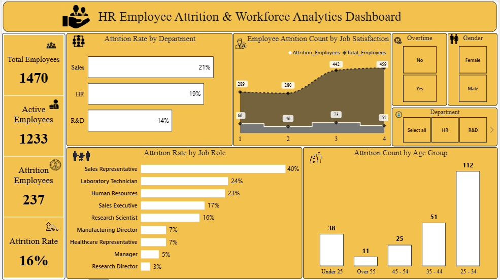
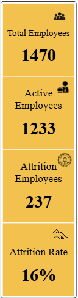
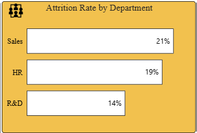
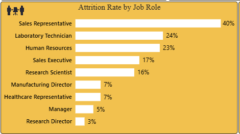
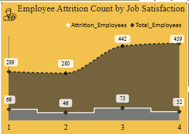
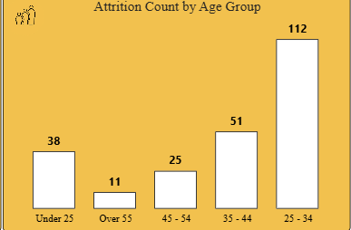

# HR Employee Attrition & Workforce Analytics Dashboard

A Power BI dashboard that explores employee attrition and workforce patterns. It brings key workforce indicators and interactive charts into one view to help users understand where employee departures are concentrated and which areas may need further HR investigation.

**Project type:** HR data analysis and dashboard development  
**Tool:** Microsoft Power BI  

## Project Overview

Employee attrition can affect workforce stability, recruitment needs, and team continuity. This project uses employee-level HR data to summarize workforce status and compare attrition across departments, job roles, job satisfaction ratings, and age groups.

The dashboard includes KPI cards, four analysis visuals, and slicers for overtime, gender, and department. Users can apply the slicers to explore different segments of the workforce.

## Dataset Details

The source workbook is `HR-Data.xlsx`. It contains 1,470 employee records and fields related to employee status, department, job role, age group, job satisfaction, gender, and overtime.

The analysis uses fields such as `Attrition`, `Department`, `Job Role`, `Job Satisfaction`, `CF_age band`, `Over Time`, `Gender`, and `Employee Number`.

## Questions This Dashboard Explores

- How many employees are represented in the dataset?
- How many employees are still active, and how many have left?
- How does attrition differ across departments?
- Which job roles have higher attrition rates?
- How are employee departures distributed across job satisfaction ratings?
- Which age groups account for more employee departures?
- Can users explore these patterns by overtime, gender, and department?

## Objectives

- Summarize the overall workforce using clear KPI cards.
- Compare attrition patterns across departments and job roles.
- Examine departure counts by job satisfaction and age group.
- Provide interactive slicers for exploring workforce segments.
- Present findings in a single, easy-to-read dashboard.

## Tools and Skills

- **Microsoft Power BI Desktop** — dashboard design and interactive reporting
- **Power Query** — data import and preparation, if used in the final PBIX workflow.,
- **DAX** — KPI and calculation measures
- **Data visualization** — KPI cards, bar charts, labels, slicers, and visual hierarchy
- **Analytical thinking** — comparing groups and translating patterns into follow-up questions

## Dashboard Preview

The dashboard uses a gold-and-white visual theme and combines KPI cards, bar charts, a job satisfaction visual, and interactive slicers.



## KPI Cards

### Total Employees

Shows the number of distinct employees included in the dataset. The dashboard displays **1,470** employees.

### Active Employees

Shows employees whose attrition status is recorded as `No`. The dashboard displays **1,233** active employees.

### Attrition Employees

Shows employees whose attrition status is recorded as `Yes`. The dashboard displays **237** employees who left.

### Attrition Rate

Summarizes the share of employees who left compared with the total employee count. The dashboard card is rounded for display.



## Visualizations and Findings

### Attrition Rate by Department

**What it shows:** Compares attrition rates across Research & Development, Sales, and Human Resources.

**How to read it:** Longer bars indicate a higher attrition rate within the department. The displayed values are rounded for readability.

**Finding:** Sales has the highest displayed department attrition rate, followed by Human Resources and Research & Development. This identifies departments that may warrant closer review; it does not explain the cause of attrition by itself.



### Attrition Rate by Job Role

**What it shows:** Compares attrition rates across the job roles represented in the dataset.

**How to read it:** Roles with longer bars have higher attrition rates relative to the employees in those roles.

**Finding:** Sales Representatives have the highest displayed rate among the roles shown. Laboratory Technicians and Human Resources roles also show comparatively high rates. HR teams could investigate role-specific factors such as workload, career progression, management support, and hiring or onboarding experiences.



### Employee Attrition Count by Job Satisfaction

**What it shows:** Displays the number of employees who left for each job satisfaction rating.

**How to read it:** The satisfaction scale runs from rating 1 through rating 4. The departure counts shown are **66, 46, 73, and 52**, respectively.

**Finding:** Rating 3 has the highest departure count in this chart. Counts alone do not show that this group has the highest attrition risk, because the total number of employees in each satisfaction group differs. A rate comparison would be needed to compare risk fairly.



### Attrition Count by Age Group

**What it shows:** Counts the employees who left in each age group.

**How to read it:** Each bar represents the number of departures in the age group. The displayed counts are:

- Under 25: **38** employees
- Ages 25–34: **112** employees
- Ages 35–44: **51** employees
- Ages 45–54: **25** employees
- Over 55: **11** employees

**Finding:** The 25–34 age group accounts for the largest number of departures. This is a count, not an attrition rate; the number of employees in each age group should be considered before comparing attrition risk.



## Interactive Filters

### Overtime

Allows users to explore the dashboard for employees marked `Yes` or `No` for overtime.

### Gender

Allows users to view workforce patterns for Female or Male employees.

### Department

Allows users to focus the dashboard on a selected department or compare the overall view with a department-specific view.

Selections may affect multiple visuals at once. When using a filter, check that the KPI cards and charts update as expected.

## How the Insights Were Identified

The dashboard compares employee attrition status with department, job role, job satisfaction, and age group. KPI cards summarize the overall workforce, while charts reveal how departures are distributed across the selected categories. Slicers allow users to narrow the view and explore whether patterns differ between workforce segments.

The findings describe patterns visible in the supplied dataset. They do not establish why an employee left or prove that a particular factor caused attrition. Further investigation, employee feedback, and additional HR context would be needed to determine possible causes.

## Problems and Questions for Further Analysis

- Why does the Sales department show a higher attrition rate than the other departments?
- What factors may contribute to the higher attrition rate among Sales Representatives?
- Why does the job satisfaction rating of 3 have the highest departure count, and how does that compare with the number of employees in that rating group?
- Why does the 25–34 age group have the largest number of departures? Is this also the group with the highest attrition rate?
- How do overtime, gender, and department selections change the patterns shown in the charts?
- Are there other employee factors—such as years at the company, income, work-life balance, or relationship with a manager—that could help explain the observed patterns?

These are questions for further analysis, not conclusions established by the current dashboard.


## KPI Definitions and Example DAX (additional)

The following measures illustrate common calculations for this type of report. Adjust the table and column names to match the actual Power BI data model. If the project already contains equivalent measures, retain the existing measures rather than creating duplicates.

```DAX
Total_Employees =
DISTINCTCOUNT('HR data'[Employee Number])

Attrition Employees =
CALCULATE(
    [Total_Employees],
    'HR data'[Attrition] = "Yes"
)

Active Employees =
CALCULATE(
    [Total_Employees],
    'HR data'[Attrition] = "No"
)

Attrition Rate =
DIVIDE(
    [Attrition Employees],
    [Total_Employees],
    0
)
```

Format `Attrition Rate` as a percentage. For the KPI card, set decimal places to 0 if you want it to display `16%`, or 2 if you want `16.12%`.

For a department or job-role attrition rate, the denominator should be the total employees in that department or role under the current filter context. The measure above preserves the current slicer context while filtering the attrition status to `Yes`.

## How to Use the Project file

1. Download or clone this repository.
2. Open the `.pbix` file in Microsoft Power BI Desktop.
3. If the source workbook is included and the file path has changed, update the source path through **Transform data → Data source settings** (or the relevant Power Query source step).
4. Refresh the data if needed.
5. Select slicer values to explore the dashboard.
6. Clear slicers to return to the overall view before comparing the headline KPIs with this README.

If you publish only screenshots and documentation, readers can review the findings but will not be able to interact with the dashboard. Include the `.pbix` file only if you are comfortable sharing the model and have permission to share its data.


## Conclusion

The dashboard provides a consolidated view of workforce size and employee attrition. It highlights differences across departments and job roles and shows how departures are distributed by job satisfaction and age group. The interactive filters support further exploration of workforce segments. The results can help identify areas for HR review, while additional analysis is needed to understand the reasons behind employee departures.

**Portfolio project:** HR Employee Attrition & Workforce Analytics Dashboard  
**Author:** Ambi Rajan **
**Skills demonstrated:** Power BI · DAX · Data Visualization · KPI Design · Workforce Analytics · Business Insight Communication
    
